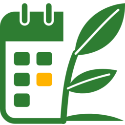
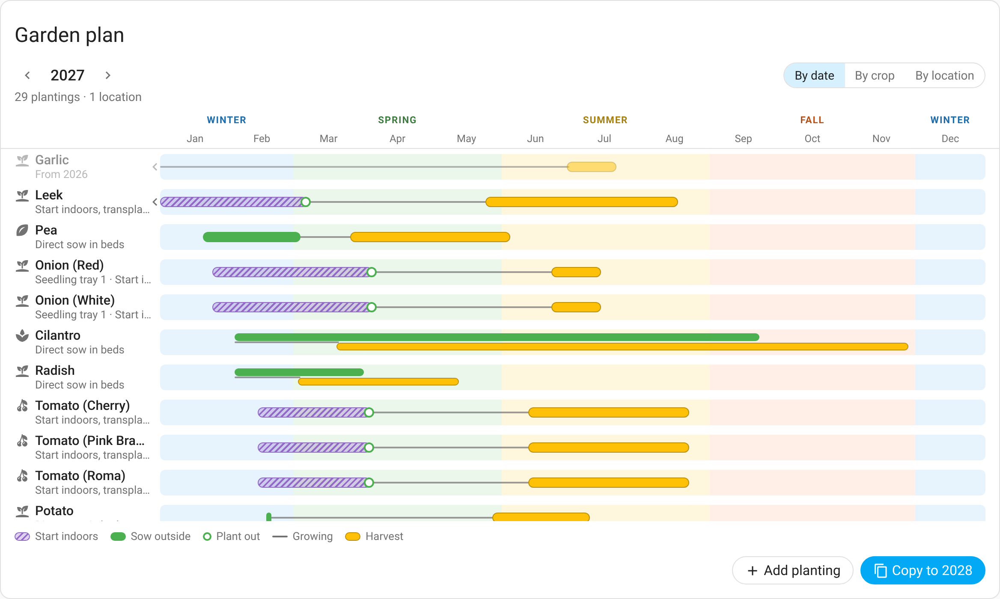
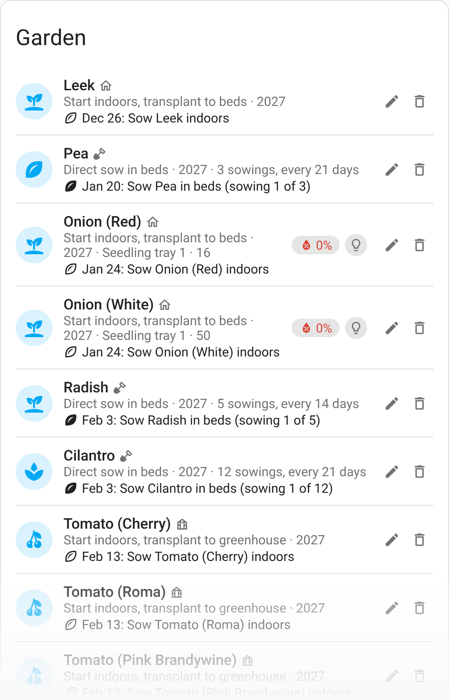
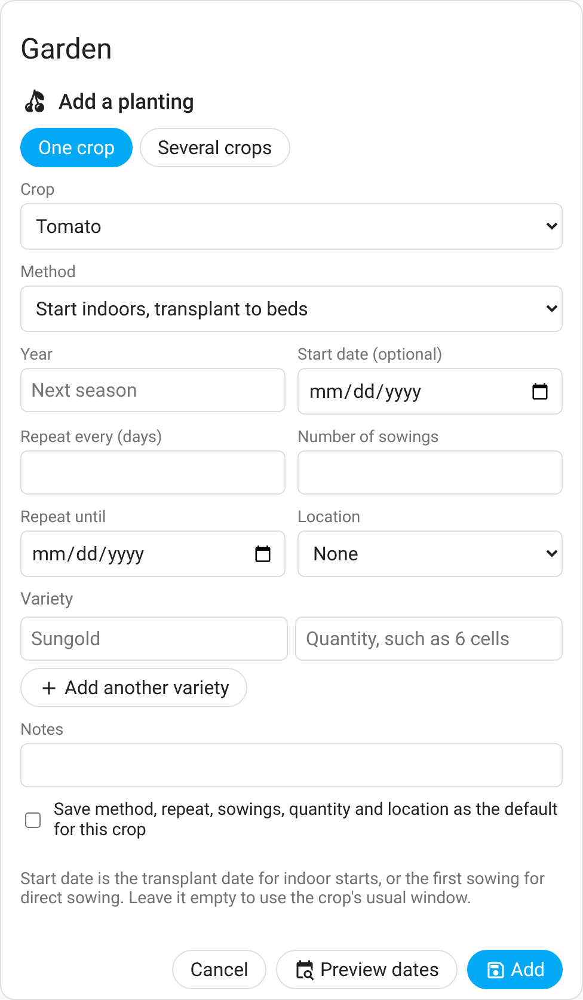
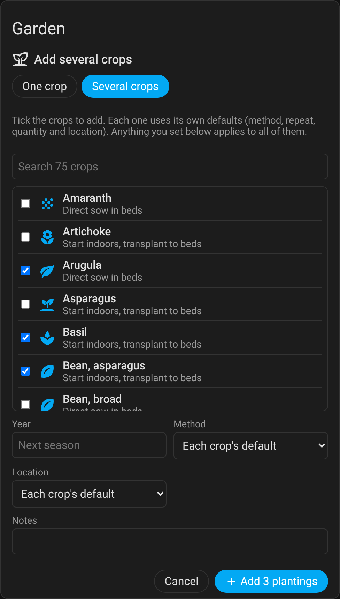
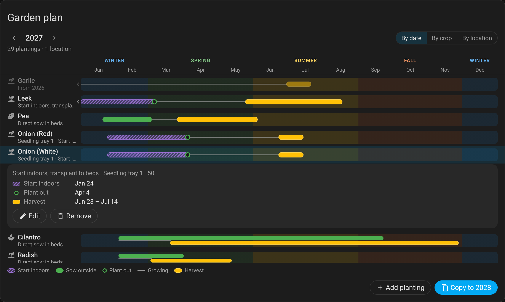
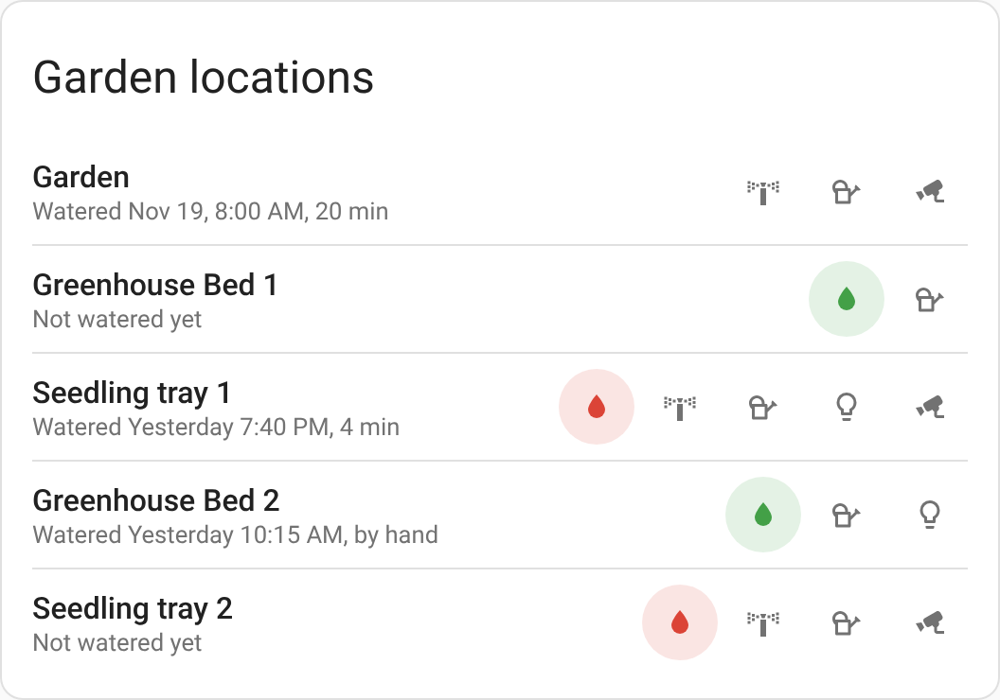
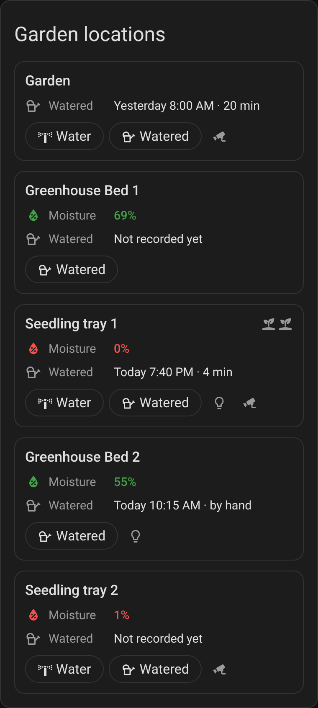

# Reap for Home Assistant

*Reap what you Sow.*

Reap turns a list of crops into dated garden tasks on a Home Assistant to-do
list: sowing indoors, potting up, hardening off, transplanting, direct
sowing, covering and harvest. It handles indoor starts, beds and greenhouses,
and repeat sowings such as carrots every three weeks. If you tick a task off
early or late, it moves the later tasks.



- **Works in any temperate garden.** Crop timings are stored relative to the
  last spring frost and first fall frost. Your own frost dates and a climate
  profile turn them into a calendar for your garden, in either hemisphere.
- **75 crops built in** (53 vegetables and 22 herbs), each with sensible
  defaults. You can add your own crops and varieties, and edit any of them.
- **Three dashboard cards** that follow your theme in light and dark mode:
  - your plantings and their next tasks;
  - a season chart of the whole year;
  - a monitoring view of your beds.
- **Locations with sensors.** Each bed or tray can have a soil moisture
  sensor, a light, a watering valve or switch, and a camera. Reap remembers
  when each one was last watered.

## Install

1. In HACS, open the three-dot menu and choose **Custom repositories**. Add
   `https://github.com/dlarkinsPonderosa/hass-garden-planner` as an
   **Integration**, then download **Reap**.
2. Restart Home Assistant.
3. Go to **Settings > Devices & services > Add integration > Reap**. Pick a
   task list, then your frost dates or your USDA hardiness zone.

More on these settings is in [Setup and settings](https://github.com/dlarkinsPonderosa/hass-garden-planner/blob/main/docs/setup.md).

## Getting started

### 1. Add the Reap card

Edit a dashboard, add a card and pick **Reap**. It lists your plantings with
their next task, and has buttons to add plantings and manage locations and
crops.



### 2. Add your plantings

Tap **Add planting** and pick a crop. Reap fills in the crop's usual method
and timing, and **Preview dates** shows every task before you save. To add a
whole garden quickly, use the **Several crops** tab: tick the crops and each
one gets its own defaults. For several varieties of one crop, such as three
tomatoes, use **Add another variety**.

<p>


</p>

Tasks then show up on your to-do list as they come due.

### 3. See the season with the planner card

Add a **Reap planner** card to see the whole year at a glance. Tap a planting
to see its dates, and use **Copy to 2028** when it's time to plan next year.
You can group the chart by date, crop or location.

To keep your main dashboard tidy, put the planner on a
[subview](https://www.home-assistant.io/dashboards/views/#subview) and set
the Reap card's `planner_path` to it. The Reap card then gets a **Plan**
button.

```yaml
views:
  - title: Garden plan
    path: plan
    subview: true
    cards:
      - type: custom:reap-planner-card
```



### 4. Set up locations and keep an eye on them

On the Reap card, open **Locations** and add your beds, trays and greenhouse.
Each one can have a soil moisture sensor, a light, a watering valve or switch,
and a camera, all optional. A planting started indoors can start in one
location, such as a seedling tray, and move to its bed when you tick off
transplanting. Then add a **Reap locations** card to watch them:

- moisture, shown green, yellow or red;
- when each location was last watered;
- a button to start watering or log a watering by hand;
- the light switch and the camera.

<p>


</p>

## Guides

- [Setup and settings](https://github.com/dlarkinsPonderosa/hass-garden-planner/blob/main/docs/setup.md):
  frost dates, climate profiles, the southern hemisphere, and upgrading from
  Garden Planner
- [Dashboard cards](https://github.com/dlarkinsPonderosa/hass-garden-planner/blob/main/docs/cards.md):
  every option for the three cards, and theme colours
- [Plantings and crops](https://github.com/dlarkinsPonderosa/hass-garden-planner/blob/main/docs/plantings.md):
  repeat sowings, crop defaults, custom crops and varieties, and how dates are
  worked out
- [Locations and watering](https://github.com/dlarkinsPonderosa/hass-garden-planner/blob/main/docs/locations.md)
- [Reference](https://github.com/dlarkinsPonderosa/hass-garden-planner/blob/main/docs/reference.md):
  entities, actions and development

If a dashboard says `Custom element doesn't exist: reap-card` (for example,
when dashboard resources are managed in YAML), add `/reap/reap-card.js` as a
**JavaScript module** under **Settings > Dashboards > Resources**.
