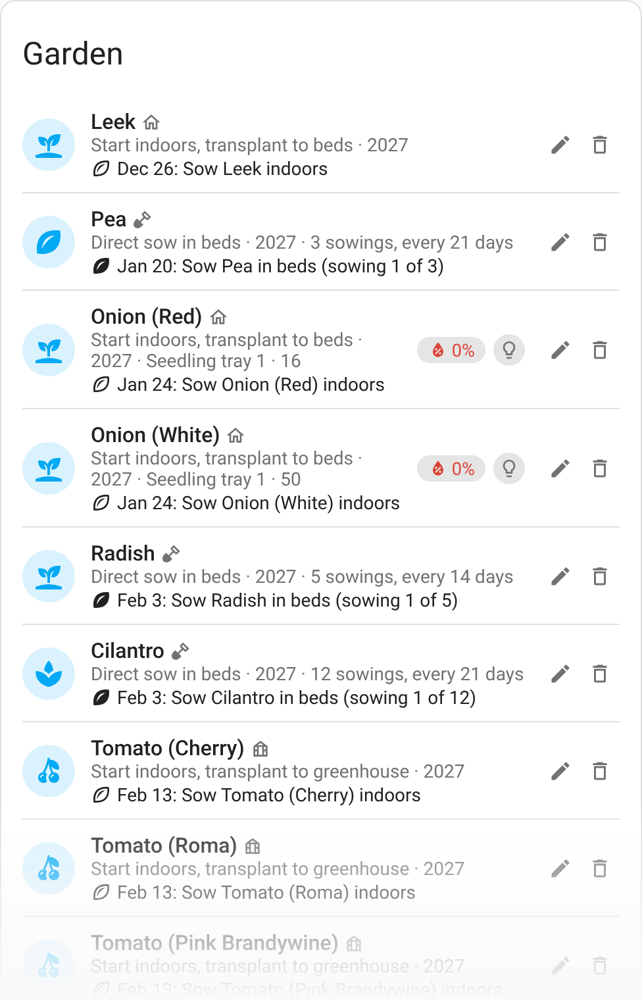
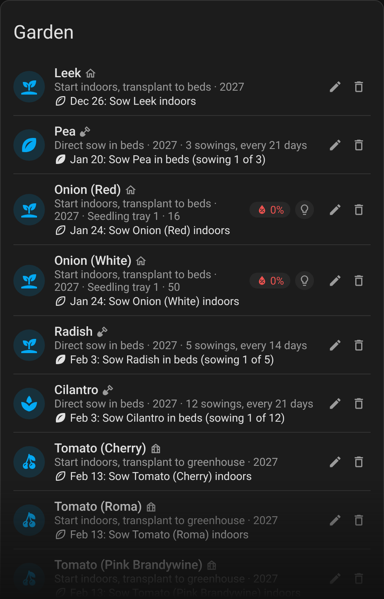
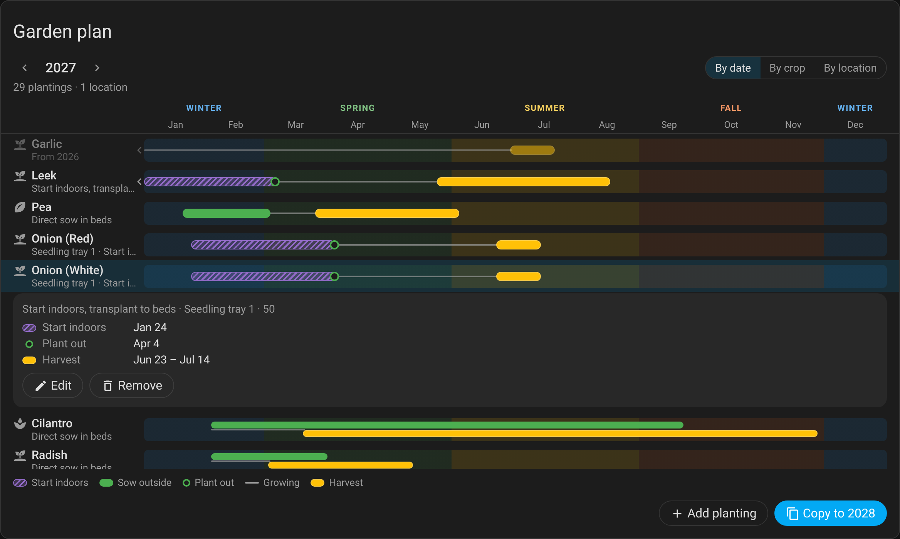
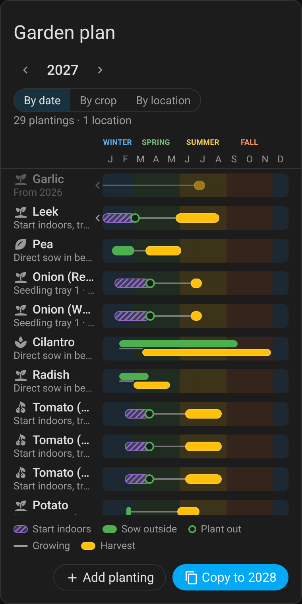
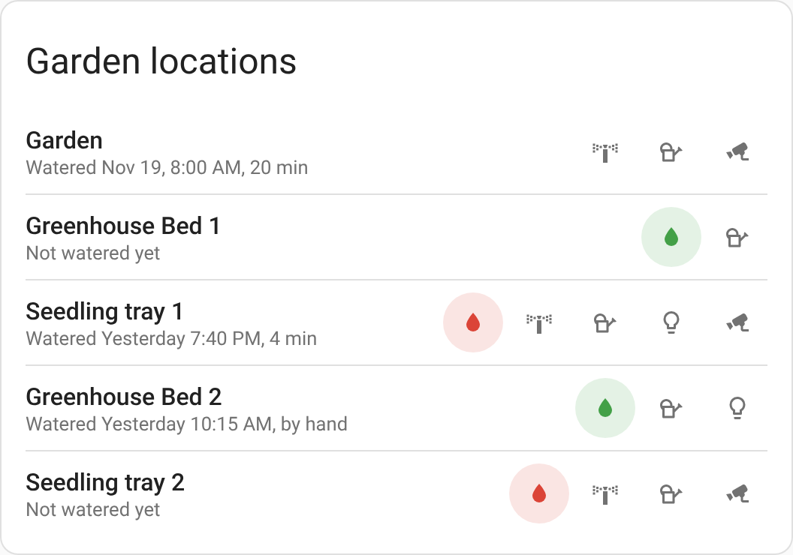
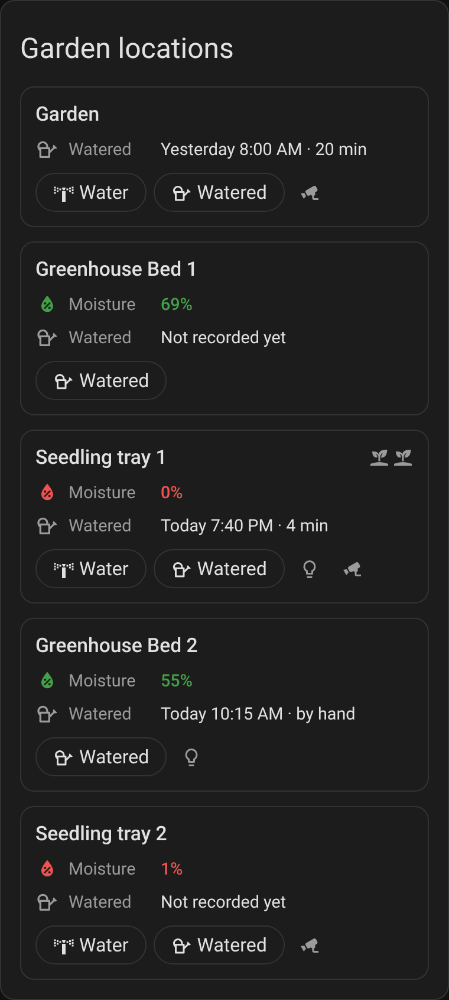

# Dashboard cards

[Back to the README](../README.md)

Reap has three cards. All of them load automatically, follow your theme in
light and dark mode, and have a visual editor.

| Card | For |
| --- | --- |
| [Reap](#reap-card) (`custom:reap-card`) | Your plantings and their next task; adding and editing plantings, locations and crops |
| [Reap planner](#planner-card) (`custom:reap-planner-card`) | A season chart of one growing year, and copying a year's plan to the next |
| [Reap locations](#locations-card) (`custom:reap-locations-card`) | Watching your beds: moisture, watering, lights and cameras |

## Reap card

The integration includes a card, loaded automatically (no separate install).
Reap adds its card to your dashboard resources when it starts. Edit a dashboard,
add a card and pick **Reap**, or use YAML:

```yaml
type: custom:reap-card
title: Garden          # optional
show_info: true        # details row: method, year, location, quantity
show_next: true        # next task row
show_sensors: true     # soil moisture and light of each planting's location
icon_size: 40          # crop icon size in pixels
editable: true         # show Add, Locations, edit and remove buttons
show_done: false       # also list plantings with no open tasks
planner_path: /lovelace/plan   # optional: adds a Plan button that opens this view
moisture_good: 30      # moisture is green above this %
moisture_low: 15       # and red below this %
```

Every option is also in the card's visual editor. When a row is turned off the
rest centre vertically.

It lists your plantings with the crop's icon, how they're grown, and the next
task with its icon and date. The pencil edits a planting, the bin removes it,
and **Add planting** opens a form. The form fills in the crop's defaults,
**Preview dates** shows every task before you save, and **Save as the default
for this crop** remembers the method, repeat interval, number of sowings,
quantity and locations (start and plant-out) for next time.

<p> </p>

## Planner card

The planner card shows one growing year as a season chart: a row for each
planting, from starting indoors and planting out to harvest, across the
months. Pick **Reap planner** when adding a card, or:

```yaml
type: custom:reap-planner-card
title: Garden plan     # optional
group_by: date         # or crop, or location
max_height: 480        # chart height in pixels before it scrolls; 0 for no limit
editable: true         # add, edit, remove and copy
```

- The arrows change year. A year runs January to December, or July to June
  in the southern hemisphere ("2027–28").
- Plantings from another year that are still in the ground show faded, such
  as fall garlic in the spring after it was planted. A planting that runs
  into the next year has an arrow at the right edge.
- Click a planting to see its dates under it, with **Edit** and **Remove**.
- **Copy to** the next year (the button names it, such as **Copy to 2028**) copies the year's plantings to the next one with the same
  settings. Untick anything you're not growing again.

It can sit on the same dashboard as the Reap card. To keep the main dashboard
simple, put it on a [subview](https://www.home-assistant.io/dashboards/views/#subview)
instead and set the Reap card's `planner_path` to that view's path, such as
`/lovelace/plan`. The Reap card then has a **Plan** button that opens it.

```yaml
views:
  - title: Garden plan
    path: plan
    subview: true
    cards:
      - type: custom:reap-planner-card
```

Its colours follow your theme in light and dark mode. Themes can set
`reap-indoor-color`, `reap-sow-color`, `reap-harvest-color`,
`reap-grow-color` and `reap-winter-color`, `reap-spring-color`,
`reap-summer-color`, `reap-fall-color` to change them.



On a phone the month names shorten and the chart still fits:



## Locations card

A card for keeping an eye on your locations (adding and editing them is on the Reap card). Each location
is one row: its name, an optional second line, then round buttons for what it has:

- a drip coloured green, yellow or red for soil moisture (tap it for the reading);
- the valve or switch, filled in while watering is running (starting asks first);
- a watering can to log a watering by hand;
- the light switch, lit up when it's on;
- the camera.

Buttons only show when they're turned on in the card and the location has that
thing, and the rest slide to the right to leave room for the name. A camera
picture can go under the row. Pick **Reap locations** when adding a card, or:

```yaml
type: custom:reap-locations-card
title: Garden locations   # optional
locations: []             # names to show, in this order; empty shows all
second_line: watered      # watered, growing (what's there now) or none (larger name)
show_moisture: true
show_valve: true          # start or stop the watering valve or switch
show_hand_watering: true  # log a watering by hand
show_light: true
show_camera: true
show_snapshot: false      # a camera picture under the row, refreshed every minute
moisture_good: 30         # green above this %
moisture_low: 15          # red below this %
```

With `second_line: growing`, plantings show up once their first task is done or
due, and drop off when their harvest is done or its window is over, so next
year's plans don't crowd the list. Locations are added and edited on the Reap card.

<p></p>
<p></p>
