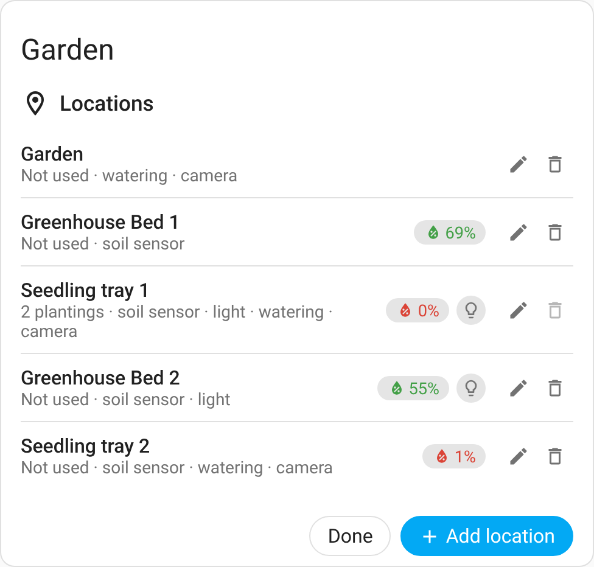

# Locations and watering

[Back to the README](../README.md)

## Setting up locations

Plantings pick their location from a list. A new install starts with
**Seedling Tray**, **Garden** and **Greenhouse**, and any locations your
plantings already used are added on upgrade. Open **Locations** on the card to
add, rename or remove them. Renaming moves the plantings with it, and a
location in use can't be removed.

Each location can have, all optional:

- a soil moisture sensor,
- a light (a light, switch or input boolean, such as grow lights),
- a watering valve or switch (a `valve`, `switch` or `input_boolean`),
- a camera.

The Reap card shows moisture and the light next to each planting in that
location: moisture in % in green above 30%, yellow from 15 to 30% and red below
15%, and a bulb icon for the light's state. Tap either for its details. The
card options `moisture_good` and `moisture_low` change the 30 and 15.

Reap remembers when each location was last watered: when its valve or switch
turns on, and for how long it ran. This survives restarts. For beds watered by
hand, the **Watered** button on the locations card (or `reap.log_watering`)
records a watering now.

Actions: `reap.add_location`, `reap.update_location`, `reap.remove_location`,
`reap.list_locations` and `reap.log_watering`.

To keep an eye on them, add the [locations card](cards.md#locations-card).
