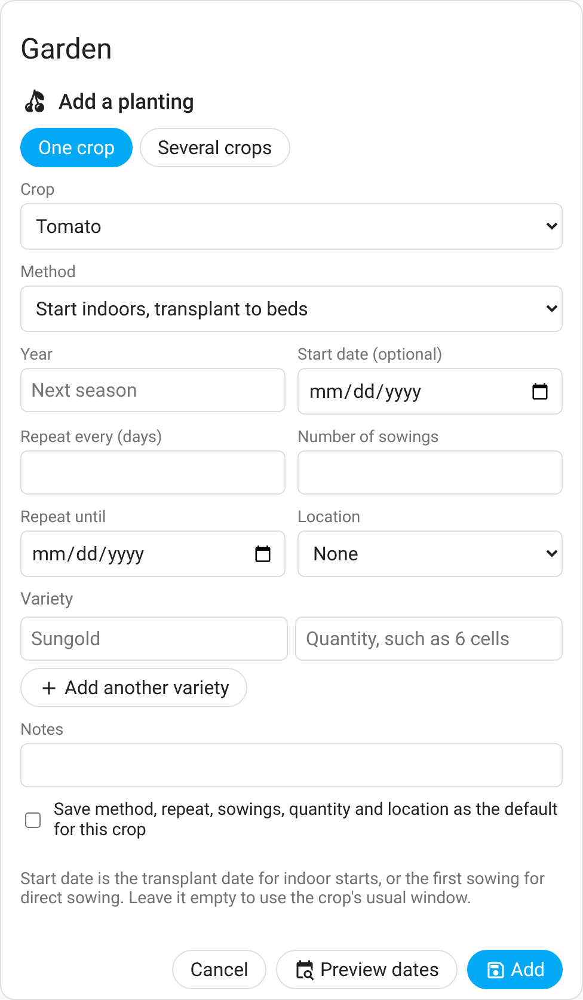
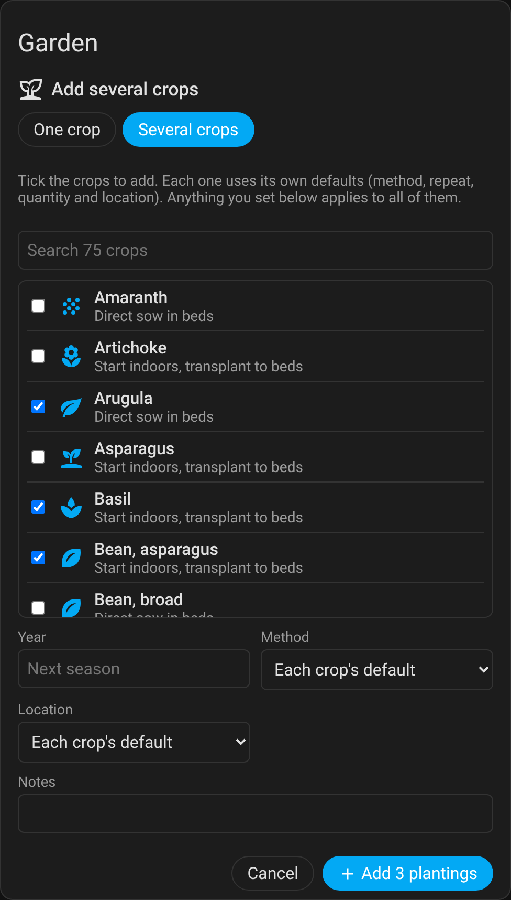

# Plantings and crops

[Back to the README](../README.md)

## Adding plantings

The quickest way is **Add planting** on the [Reap card](cards.md#reap-card).
Pick a crop and the form fills in its usual method and timing. **Preview
dates** shows every task before you save.

Without the card, go to **Settings > Devices & services > Reap > Configure** and pick
**Add a planting**:

1. Choose the crop.
2. Choose how it's grown (only the methods that crop supports are offered),
   and optionally a start date, repeat sowings, variety, quantity and location.
3. Check the list of dates, then submit.

**Remove plantings** and **Settings** are on the same menu.

You can also use the `reap.add_planting` action from Developer tools
> Actions, a script or a dashboard button.

```yaml
action: reap.add_planting
data:
  crop: carrot
  method: direct_bed
  succession_days: 7        # sow again every week
  succession_until: "2027-07-01"
  location: Bed 3
```

| Field | Notes |
| --- | --- |
| `crop` | Catalog key, such as `tomato`, `pepper`, `garlic` |
| `method` | `indoor_bed`, `indoor_greenhouse`, `direct_bed`, `direct_greenhouse`. Defaults to the crop's default method |
| `year` | Defaults to the next season the crop can still be sown in: this year if its window hasn't ended, otherwise next year |
| `season` | For crops with more than one window, such as `fall` for garlic or broad beans |
| `start_date` | Transplant date (indoor methods) or first sowing date (direct). Defaults to the start of the crop's window |
| `succession_days`, `succession_count`, `succession_until` | Repeat sowings |
| `location` | Where it's planted out, or sown for direct sowing |
| `start_location` | Indoor starts only: where it starts, until its transplant task is ticked off. See [Locations](locations.md#starting-indoors-then-planting-out) |
| `variety`, `quantity`, `notes` | Shown on the tasks |

`reap.preview_planting` takes the same fields and returns the tasks
without saving anything. `reap.update_planting` takes a
`planting_id` plus any fields to change (an empty value clears a field). `reap.remove_planting` removes a planting
and its open tasks (completed ones stay on your list).



## Several at once

On the card, **Add planting** has two tabs:

- **One crop**: under the variety, **Add another variety** makes one planting
  per variety (Sungold, Brandywine, San Marzano...), each with its own
  quantity and the same method, dates and location.
- **Several crops**: tick the crops you want. Each one starts from its own
  defaults (method, repeat, quantity, location). A year, method, location or
  notes set on the form apply to all of them; a method is only used for crops
  that can be grown that way.

**Copy to** on the [planner card](cards.md#planner-card) copies a year's plantings to
another year with the same settings, moving start and repeat-until dates with
them. Plantings already planned for the new year start unticked.

The same as actions:

```yaml
action: reap.add_plantings
data:
  plantings:
    - crop: lettuce
    - crop: tomato
      variety: Sungold
      location: Greenhouse
---
action: reap.copy_plantings
data:
  from_year: 2026      # to_year defaults to the next year
```

`add_plantings` adds all of them, or none if one can't be scheduled. Set
`use_defaults: false` to skip the crops' saved defaults.



## Crop defaults

Each crop starts with sensible defaults: crops usually started indoors default
to indoor starts, and quick crops are set to repeat (radishes, lettuce,
arugula and spinach every 2 weeks; carrots, beets, cilantro and dill every 3;
peas, bush beans and corn a few times). Change them from the card or the
Configure menu with "Save as the default", or with the action:

```yaml
action: reap.set_crop_defaults
data:
  crop: carrot
  method: direct_bed
  succession_days: 14
  location: Bed 3
```

`clear: true` goes back to the built-in defaults. A planting can always
override them.

## Custom crops and varieties

To add a crop or variety that isn't built in, open **Crops** on the card and
choose **Add crop**, or go to **Settings > Devices & services > Reap >
Configure > Add a crop or variety**. Give it a name, a category and an icon,
then either:

- **copy timing from** an existing crop (best for a variety, such as a
  particular tomato), changing only what differs, like days to harvest, or
- enter the dates you'd usually start it indoors, transplant it, or sow it
  directly in spring or fall in your garden.

Dates you enter are saved relative to your frost dates, so they follow any
later change to your settings.

The built-in crops are just a starting list. Every crop, built-in or your own,
can be edited from the card, and removed once no planting uses it. Edited
built-in crops have an undo button that puts back the original, and removed
ones are listed under **Removed crops** with a **Restore** button
(`reap.reset_crop` does the same).

The same is available as an action:

```yaml
action: reap.add_crop
data:
  key: tomato_sungold
  name: Tomato, Sungold
  based_on: tomato
  days_to_harvest: 105
  icon: mdi:fruit-cherries
```

A crop without `based_on` needs `windows`. Ranges can be calendar dates
(MM-DD) or offsets from your frost dates (`L-14`, `F+7`):

```yaml
  windows:
    - season: spring
      indoor: ["03-01", "04-15"]
      transplant: ["05-01", "06-15"]
```

Using a built-in key overrides that crop. `reap.list_crops` returns every crop
with its icon, category, methods, seasons and defaults.

## How dates are worked out

- **Frost offsets**: each crop window is stored as offsets such as `L-31`
  (31 days before last frost) or `F-57` (57 days before first frost). Spring
  steps are measured from the last frost and late-season steps from the first
  frost. Your frost dates and offset turn them back into calendar dates.

- **Indoor starts**: sow indoors = transplant date minus the crop's weeks
  indoors (tomato 7, pepper 10, onion and leek 10). Tomatoes, peppers,
  eggplant, tomatillos and artichokes get a pot-up task halfway.
- **Greenhouse**: every window opens 4 weeks earlier and closes 4 weeks later.
- **Harvest**: sowing date plus days to harvest, for the crop's harvest weeks.
  Crops that overwinter (fall garlic and fava, overwintering onion and
  cabbage) are harvested the next spring or summer, whenever they went in.
- **Ticking a task off**: the date you tick it is recorded. If it was 5 days
  late, the rest of that planting's tasks move 5 days later. Un-ticking undoes
  it. Deleting a task from the list means it won't be added back.
- **Notes on a task**: Reap keeps each item's description up to date (quantity,
  location, notes) down to its `reap:` line. Anything you type below that line
  is yours and is kept.
